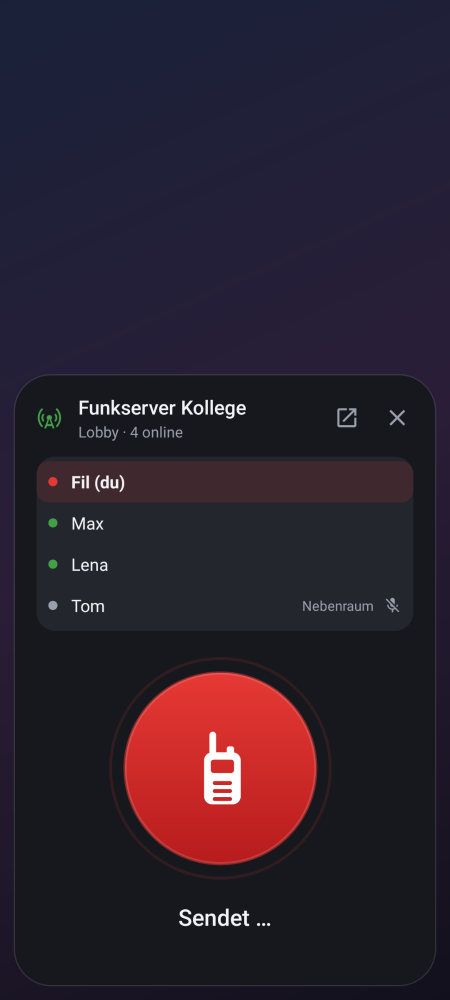
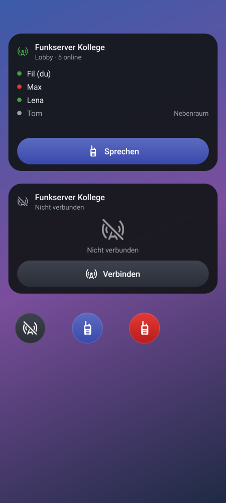
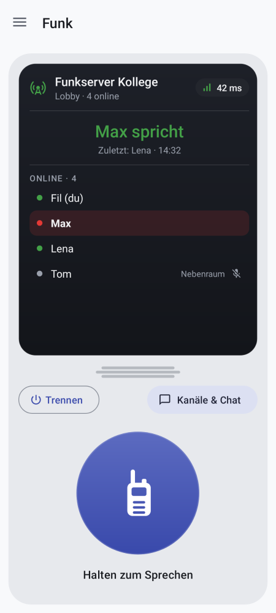
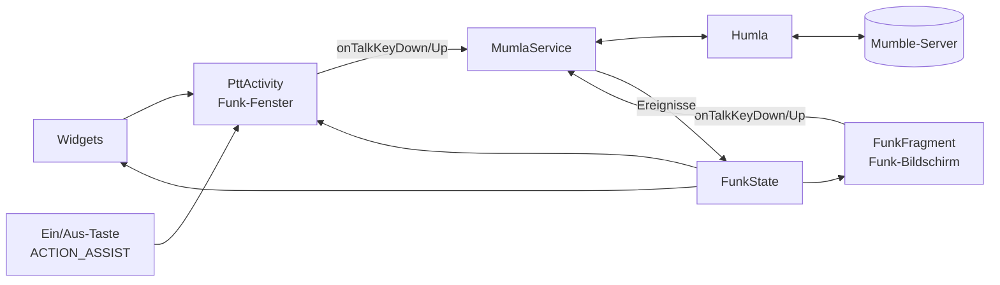

<p align="center"></p>

# Mumla Funk

**Mumble als Walkie-Talkie auf Android.**

Mumla Funk ist ein Fork von [Mumla](https://gitlab.com/quite/mumla), dem freien
Mumble-Client für Android. Das Mumble-Backend bleibt unverändert: Die App verbindet sich mit
jedem Mumble-Server. Neu ist die Bedienung: Für jeden Server lässt sich einstellen, ob er ein
Funk-Server ist. Dann gibt es statt einer Chat-App mit vielen Menüs eine große Sprechtaste,
die man auch erreicht, ohne die App zu öffnen, über die Ein/Aus-Taste oder ein
Homescreen-Widget. Alle anderen Server zeigen die gewohnte Mumla-Ansicht mit Kanälen und Chat.

## Wozu?

Eine Gruppe nutzt einen eigenen Mumble-Server als Funknetz. Jeder spricht per Push-to-Talk,
der Server legt Funkgeräusche und Effekte über die Stimmen. Auf dem Handy braucht man dafür:

- **Sprechen wie mit einem Funkgerät**: schnell, ohne Hinschauen, ohne durch Menüs zu tippen.
- **Den Überblick auf einen Blick**: Bin ich verbunden? Wer ist da? Wer spricht gerade?
- **Ein sauberes Sende-Ende**: Beim Loslassen muss das Ende-Signal der Durchsage sofort
  ankommen, denn serverseitige Effekte reagieren darauf. Mumla hat es nicht zuverlässig gesendet.

Mumla beherrscht das Mumble-Protokoll, ist aber ein allgemeiner Mumble-Client. Mumla Funk
behält das komplette Mumla und setzt eine Funk-Bedienung obendrauf.

| Funk-Fenster | Beim Senden | Widgets | Funk-Bildschirm |
|:---:|:---:|:---:|:---:|
|  |  |  |  |

<sub>Gerenderte Vorschau der echten Layouts mit Beispieldaten.</sub>

## Funktionen

- **Funk-Server oder normaler Server**: pro Server einstellbar (Schalter „Funk-Server“ beim
  Anlegen und Bearbeiten). Nach dem Verbinden zeigt die App bei Funk-Servern den
  Funk-Bildschirm, sonst Mumlas Kanalliste mit Chat. Öffentliche Server und „Schnell verbinden“
  nutzen immer die normale Ansicht.
- **Funk-Fenster**: ein großer Knopf, gedrückt halten zum Sprechen, loslassen beendet.
  Es zeigt Server, Verbindung und wer gerade spricht. Ist man nicht verbunden, verbindet ein
  Tipp auf den Knopf. Solange das Fenster offen ist, ist die Leiser-Taste die Sprechtaste.
  Es erscheint über jeder App und auch über dem Sperrbildschirm.
- **Ein/Aus-Taste gedrückt halten** öffnet das Funk-Fenster (Mumla Funk als digitaler Assistent).
- **Zwei Homescreen-Widgets**, jeweils fest an einen Server gebunden:
  - ein kleiner runder Funk-Knopf,
  - ein großes Widget mit Status, allen Teilnehmern und einem Knopf für Sprechen oder Verbinden.
  
  Ohne Verbindung zeigen beide einen durchgestrichenen Funkmast.
- **Startbildschirm**: die Serverliste. Ohne Server erklärt eine Willkommen-Seite den Einstieg
  und bietet „Server hinzufügen“ und die öffentlichen Server an. Das Server-Formular zeigt
  Beispiele und Hinweise zu jedem Feld.
- **Funk-Bildschirm**: Server, Status, Sprechtaste und Teilnehmerliste.
- **Zuverlässiges Sende-Ende**: Beim Loslassen wird immer das Ende-Flag (Terminator) gesendet,
  wie beim Desktop-Client.
- **Energiesparen**: Mikrofon nur beim Senden, Ruhezustand wenn niemand spricht, das Handy
  darf schlafen. Siehe [Energiesparen](#energiesparen).
- **Alles aus Mumla bleibt**: Kanäle, Chat, Zertifikate, Zugriffstoken, Tor, Overlay und alle
  Einstellungen sind über das Menü erreichbar.

## Unterschiede zu Mumla

| | Mumla | Mumla Funk |
|---|---|---|
| App | `se.lublin.mumla` | `de.filubu.funk`, parallel zu Mumla installierbar |
| Standard-Eingabe | Sprachaktivierung | Push-to-Talk |
| Startbildschirm | Serverliste | Serverliste mit Einstiegshilfe, nach dem Verbinden je nach Server Funk-Bildschirm oder Kanalliste |
| Hardware-Tasten | nur bei geöffneter App | Ein/Aus-Taste (Assistent), Leiser-Taste im Funk-Fenster |
| Widgets | keine | klein und groß |
| Leerlauf | Handy dauerhaft wach, Mikrofon offen, Ping alle 5 s | Mikrofon aus, Ruhe-Ping alle 2 min, Handy darf schlafen |
| Ende-Flag beim Loslassen | fehlt bei Standardeinstellung etwa jedes zweite Mal | immer |
| Humla (Protokoll-Bibliothek) | Git-Submodul | direkt im Repo, gepatcht |
| Spenden-Links, Billing | ja (je nach Variante) | keine |
| Steuerung durch andere Apps | jede App kann per Broadcast das Senden auslösen | nicht möglich |
| Build-Varianten | `foss`, `goog`, `donation`, `beta` | eine |
| Version | 3.7.3 | eigene Zählung ab 1.0.0 |

## Installation und Einrichtung

Die APK gibt es unter [Releases](https://github.com/Filubu/mumla-funk/releases).
Voraussetzung ist Android 5.0 oder neuer.

**Umstieg von 1.0.3 oder älter:** Ab 1.0.4 heißt das Paket `de.filubu.funk` statt
`io.github.filubu.mumlafunk`. Android installiert 1.0.4 daher als eigene App neben der alten.
Vorher in der alten Version das Zertifikat exportieren (Einstellungen › Authentifizierung), in
1.0.4 importieren, die Server neu anlegen und danach die alte Version deinstallieren.

1. **App installieren** und auf der Willkommen-Seite „Server hinzufügen“ antippen. Adresse,
   Benutzername und ggf. Passwort eintragen, „Funk-Server“ an lassen (für die normale
   Mumble-Ansicht ausschalten). Danach den Server antippen. Beim ersten Mal fragt die App, ob
   sie dem Zertifikat des Servers vertrauen soll: „Vertrauen und verbinden“.
   Mumla Funk ist eine eigene App, Server und Zertifikat aus Mumla werden nicht übernommen. Wer
   auf dem Server registriert ist, exportiert das Zertifikat in Mumla
   (Einstellungen › Authentifizierung) und importiert es in Mumla Funk.
2. **Ein/Aus-Taste**: Einstellungen › Funk › „Ein/Aus-Taste halten öffnet Funk“ antippen und
   Mumla Funk als *Standard-App für den digitalen Assistenten* wählen. Dann in den
   Android-Einstellungen unter System › Gesten › „Ein/Aus-Taste gedrückt halten“ den digitalen
   Assistenten einstellen (Pixel; bei anderen Herstellern ähnlich benannt).
3. **Widgets**: Homescreen lange drücken › Widgets › Mumla Funk, dann den Server auswählen.
4. **Akku**: Einstellungen › Funk › „Schlafen erlauben“ öffnet die Liste der Akku-Optimierung.
   Dort Mumla Funk auf „Nicht optimieren“ bzw. „Nicht eingeschränkt“ stellen. Auf dem Server
   `timeout=300` setzen (siehe [Energiesparen](#energiesparen)).

## Energiesparen

Mumla hielt das Handy dauerhaft wach, ließ das Mikrofon offen und pingte den Server alle
5 Sekunden an. Dadurch kam das Mobilfunkmodem nie zur Ruhe. Mumla Funk macht das so:

- **Mikrofon nur beim Senden** (Sprechtasten-Modus). Es wird beim Drücken eingeschaltet
  und beim Loslassen wieder freigegeben.
- **Ruhezustand**: 30 s nach der letzten Durchsage (egal von wem) geht die Verbindung in den
  Ruhezustand. Dann gibt es nur noch einen Ruhe-Ping alle paar Minuten (Einstellung, Standard
  2 min). Sprache kommt über TCP statt UDP, weil Mobilfunknetze UDP-Verbindungen schon nach
  etwa einer Minute Stille vergessen. Wer spricht oder angesprochen wird, ist sofort wieder
  im Normalbetrieb (UDP, Ping alle 5 s).
- **Handy darf schlafen**, wenn Mumla Funk von der Akku-Optimierung ausgenommen ist
  (Einstellungen › Funk › „Schlafen erlauben“). Die App fragt nicht selbst danach, denn die
  dafür nötige Berechtigung schränkt Google Play ein. Ankommende Daten wecken das
  Handy von selbst. Ohne die Ausnahme bleibt das Handy wach wie bisher, gespart wird dann nur
  beim Funkmodul. Grund: Android stellt Wecker im Tiefschlaf nur ausgenommenen Apps pünktlich zu.
- **Tote Verbindung erkennen**: Kommt auf einen Ruhe-Ping 15 s lang keine Antwort, verbindet
  die App neu. Das Neuverbinden klappt auch, während das Handy schläft.
- Abschaltbar unter Einstellungen › Funk › „Energie sparen, wenn niemand spricht“.
  Dann verhält sich die Verbindung wie früher (nur das Mikrofon bleibt trotzdem aus).

**Server einstellen (wichtig):** Ein Mumble-Server trennt Clients, von denen er länger nichts
hört (Standard: 30 s). Das muss länger sein als der Ruhe-Ping, am besten mehr als das
Doppelte. In der `mumble-server.ini` (früher `murmur.ini`):

```ini
timeout=300
```

Danach den Server neu starten. Passende Werte:

| Ruhe-Ping in der App | `timeout=` im Server |
|---|---|
| 20 s | Standard (30) reicht |
| 1 min | mindestens 120 |
| 2 min (Standard) | mindestens 300 |
| 4 min | mindestens 600 |

Ein höherer `timeout` hat einen Nachteil: Verliert ein Handy plötzlich das Netz, steht es bis
zu dieser Zeit noch als „online“ in der Liste. Vergisst man die Einstellung, merkt die App das:
Wird die ruhende Verbindung zweimal hintereinander getrennt, nimmt sie bis zum nächsten
Verbinden 20 s und schreibt einen Hinweis in den Chat.

**Messen:** Mit `adb shell dumpsys deviceidle force-idle` lässt sich der Tiefschlaf (Doze)
erzwingen, mit `adb shell dumpsys deviceidle unforce` beenden. Den Verbrauch zeigt
Einstellungen › Akku › Akkunutzung, genauer `adb shell dumpsys batterystats de.filubu.funk`.

### Grenzen, die von Android kommen

- **Widgets** erkennen nur Antippen, kein Gedrückthalten. Darum öffnen sie das Funk-Fenster.
- **Ein/Aus-Taste**: Android meldet nur „lange gedrückt“, nicht das Loslassen. Darum öffnet
  auch sie das Funk-Fenster. Bei gesperrtem Gerät fragt Android zuerst nach dem Entsperren.

## Für Entwickler

### Projektstruktur

```
app/                                Android-App: Mumla plus die Funk-Erweiterungen
  src/main/java/se/lublin/mumla/
    funk/                           alles Neue von Mumla Funk (Funk-Fenster, Zustand, Tasten)
    funk/widget/                    Homescreen-Widgets und deren Einrichtung
    service/MumlaService.java       Vordergrunddienst, hält die Mumble-Verbindung
    app/MumlaActivity.java          Haupt-Activity mit Menü (Drawer)
    channel/, servers/, preference/ Mumla-Oberfläche: Kanäle, Chat, Serverliste, Einstellungen
libraries/humla/                    Mumble-Protokoll (Humla), im Repo und gepatcht
  src/main/jni/                     Opus, Speex, CELT als Submodule, per NDK gebaut
  libs/humla-spongycastle/          Krypto-Bibliothek als Submodul, wird als JAR gebaut
docs/                               Architektur, Bilder, Original-README von Mumla
.github/workflows/release.yml       Release-Workflow
```

Die Java-Pakete heißen weiterhin `se.lublin.mumla`. Nur die Application-ID ist neu. So bleiben
Updates aus Mumla leichter übernehmbar.

### Architektur in Kürze



- Alle Wege zum Sprechen laufen über `IMumlaService.onTalkKeyDown()/onTalkKeyUp()`.
  Push-to-Talk-Modus und Umschaltmodus aus den Einstellungen gelten damit überall.
- `MumlaService` fasst Verbindungs- und Teilnehmer-Ereignisse zu einem unveränderlichen
  Schnappschuss `FunkState` zusammen. Funk-Fenster, Funk-Bildschirm und Widgets zeigen nur
  diesen Zustand an.
- Der Ende-Flag-Fix steckt in `libraries/humla/.../protocol/AudioHandler.java`.

Details zu allen Teilen, Abläufen und Design-Entscheidungen stehen in
[docs/ARCHITEKTUR.md](docs/ARCHITEKTUR.md).

### Bauen

Benötigt werden JDK 21, das Android SDK (Plattform 36) und das NDK `25.1.8937393`.

```bash
git clone --recursive https://github.com/Filubu/mumla-funk.git
cd mumla-funk
(cd libraries/humla/libs/humla-spongycastle && ../../gradlew jar)
./gradlew assembleDebug
```

Die APK liegt danach in `app/build/outputs/apk/debug/`. Bei einem Klon ohne
`--recursive` holt `git submodule update --init --recursive` die Submodule nach.

Es gibt seit 1.0.5 nur noch eine Build-Variante, ohne Google-Bibliotheken, Spenden-Links und
Billing. Dieselbe App geht als APK auf GitHub (`./gradlew assembleRelease`) und als App
Bundle zu Google Play (`./gradlew bundleRelease`). Mumlas Varianten `foss`, `goog`, `donation`
und `beta` sind entfernt.

### Releases

Ein Release wird auf GitHub mit einem Tag `vX.Y.Z` angelegt. Der Workflow
`.github/workflows/release.yml` läuft dabei mit und entscheidet:

- Hängt am Release schon eine APK (von Hand hochgeladen), ist nichts zu tun.
- Liegt im getaggten Commit eine fertig signierte APK unter `release/`, wird sie angehängt.
- Sind die Repository-Secrets gesetzt, baut und signiert er die APK selbst und hängt sie an:
  - `MUMLA_FUNK_KEYSTORE_BASE64`: der Keystore, base64-kodiert (`base64 -w0 mumla-funk-release.jks`)
  - `MUMLA_FUNK_KEYSTORE_PASSWORD`: das Keystore-Passwort (Alias `mumlafunk`)
- Sonst endet er mit einer Warnung, ohne Fehler.

In einem Fork müssen GitHub Actions einmal im Tab „Actions“ aktiviert werden.

Für Google Play baut der Workflow `.github/workflows/play.yml` mit denselben Secrets ein
signiertes App Bundle. Alles zum Play Store, vom Konto bis zum internen Test, steht in
[play/README.md](play/README.md).

Version und Versionscode stehen in `app/build.gradle` (`funkVersion`, `versionCode`).

Updates lassen sich nur installieren, wenn sie mit **demselben** Schlüssel signiert sind.
Der Schlüssel gehört deshalb sicher aufbewahrt und **nie** ins Repository. Lokal signiert
`app/signing.gradle` (per `.gitignore` ausgeschlossen) mit den Umgebungsvariablen
`MUMLA_FUNK_KEYSTORE` und `MUMLA_FUNK_KEYSTORE_PASSWORD`.

### Testen

Für die Funk-Oberfläche gibt es keine automatischen Tests. Vor einem Release lohnt sich ein
Durchgang auf einem echten Gerät:

- **Funk-Fenster**:
  - verbinden, sprechen, loslassen,
  - Leiser-Taste als Sprechtaste,
  - Fenster schließen während des Sendens: das Senden muss enden.
- **Ein/Aus-Taste** (als Assistent eingerichtet) bei entsperrtem und bei gesperrtem Gerät.
- **Start ohne Server**: Willkommen-Seite, „Server hinzufügen“, Fehlermeldungen im Formular
  (leere Adresse, URL statt Adresse, kein Name), danach „Verbinden“ in der Meldung unten.
- **Funk-Schalter**: ein Funk-Server öffnet nach dem Verbinden den Funk-Bildschirm, ein Server
  mit ausgeschaltetem Schalter und ein öffentlicher Server die Kanalliste. Umschalten im
  Bearbeiten-Dialog, während man verbunden ist, wechselt die Ansicht sofort.
- **Dunkles Design**: Texte, Schalter und Knöpfe in Funk-Bildschirm, Serverliste und
  Einstellungen gut lesbar.
- **Widgets**:
  - einrichten,
  - Verbindungsaufbau aus dem Widget,
  - Wechsel auf einen anderen Server,
  - Anzeige von Sprechern und Teilnehmern.
- **Energiesparen**: Nach 30 s Stille steht im Log (`adb logcat | grep IdleController`)
  „idle“; eine Durchsage im Ruhezustand muss ankommen, mit gesperrtem Handy und erzwungenem
  Doze ebenso.
- **Ende-Flag**: In einem Desktop-Mumble-Client auf demselben Server muss die Sprechanzeige
  sofort beim Loslassen ausgehen und nicht erst verzögert. Ebenso sollten die Server-Effekte
  sofort reagieren.

### Updates aus Mumla übernehmen

```bash
git remote add upstream https://gitlab.com/quite/mumla.git
git fetch upstream
git merge upstream/master
```

Konflikte sind vor allem in diesen Dateien zu erwarten:

- `app/build.gradle`
- `MumlaActivity.java`
- `MumlaService.java`
- `AndroidManifest.xml`
- den Icons

Humla liegt nicht mehr als Submodul vor. Neuere Humla-Versionen werden nach
`libraries/humla/` kopiert. Danach muss der Ende-Flag-Fix wieder enthalten sein (siehe
`docs/ARCHITEKTUR.md`).

### Mitmachen

Fehler und Ideen zur Funk-Bedienung bitte hier als
[Issue](https://github.com/Filubu/mumla-funk/issues) melden. Allgemeine Fehler, die genauso in
Mumla auftreten, gehören zu [Mumla](https://gitlab.com/quite/mumla/-/issues).

## Lizenz und Herkunft

Mumla Funk steht wie Mumla unter der [GNU GPL v3](LICENSE).

Herkunft:

- Mumla Funk ist ein Fork von [Mumla](https://gitlab.com/quite/mumla) (Daniel Lublin).
- Mumla ist ein Fork von [Plumble](https://github.com/acomminos/Plumble) (Andrew Comminos).
- Das Protokoll stammt aus [Humla](https://gitlab.com/quite/humla), einem Fork von
  [Jumble](https://github.com/acomminos/Jumble).

Das Original-README von Mumla mit FAQ und Build-Hinweisen liegt unter
[docs/MUMLA-UPSTREAM.md](docs/MUMLA-UPSTREAM.md).
