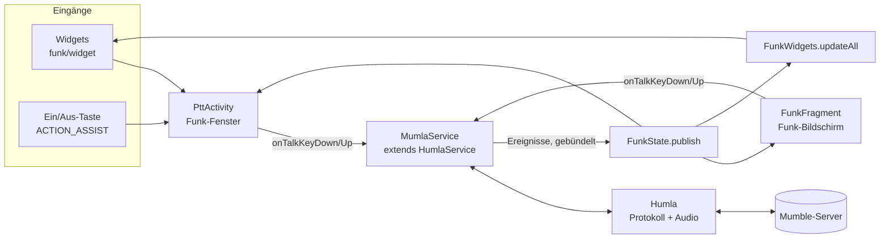
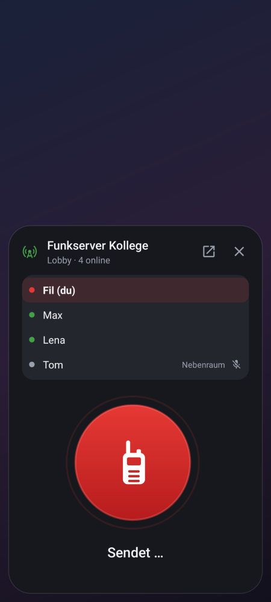
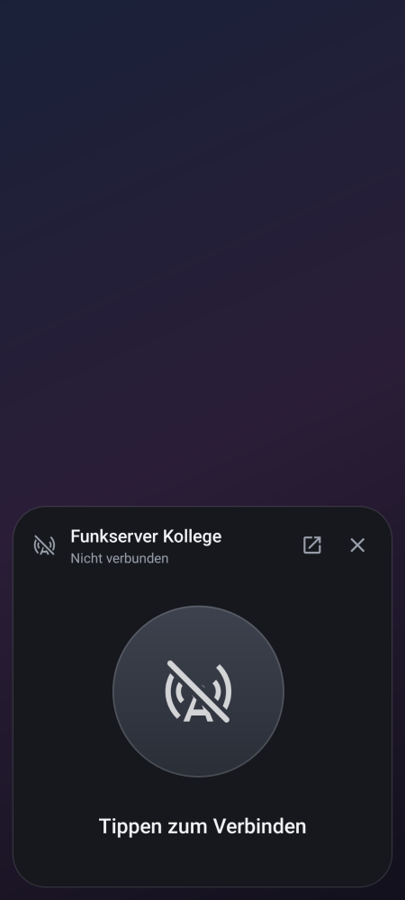

# Architektur von Mumla Funk

Dieses Dokument beschreibt, was Mumla Funk auf Mumla aufsetzt, wie die Teile zusammenspielen
und warum sie so gebaut sind. Für Überblick, Bauen und Releases siehe das [README](../README.md).

Mumla Funk besteht aus drei Schichten:

1. **Humla** (`libraries/humla/`): das Mumble-Protokoll, also Verbindung, Audio und Codecs.
   Aus Mumla übernommen, geändert sind der [Ende-Flag-Fix](#ende-flag-terminator), das
   Energiesparen und zwei Abfragen für das Display (`isConnectionIdle()`, `getLatencyMillis()`).
2. **Mumla** (`app/`, Pakete außer `funk`): Vordergrunddienst, Kanäle, Chat, Serverliste,
   Zertifikate und Einstellungen. Nahezu unverändert.
3. **Funk** (`app/src/main/java/se/lublin/mumla/funk/`): die Walkie-Talkie-Bedienung. Sie
   spricht ausschließlich über die vorhandenen Service-Schnittstellen mit dem Backend.

## Überblick

## Klassen und Dateien

| Datei | Aufgabe |
|---|---|
| `funk/FunkState.java` | Unveränderlicher Schnappschuss: Verbindung, Server, eigener Kanal, alle Teilnehmer, wer spricht, ob man stumm ist. Statischer „aktueller Zustand“ plus Listener. Merkt sich, wer zuletzt gesprochen hat. |
| `funk/PttActivity.java` | Funk-Fenster: Teilnehmerliste, großer Sprechknopf für einen Server, Verbindungsaufbau, Fehleranzeige, Leiser-Taste als Sprechtaste. |
| `funk/FunkMemberList.java`, `res/layout/funk_member_row.xml` | Teilnehmerzeilen für das Display und die Liste im Funk-Fenster (beide dunkel), Zeilen werden wiederverwendet. |
| `funk/PttButtonView.java` | Der runde Knopf als eigene View: Zustände OFFLINE, CONNECTING, READY, TALKING, MUTED; Federn beim Drücken, Überblenden zwischen den Zuständen, Puls beim Senden, Haptik, Touch-Logik (halten oder tippen). |
| `funk/FunkMotion.java` | Kurven, Dauern und das Überblenden von Texten für alle Animationen, siehe [Design](#design). |
| `funk/FunkFragment.java`, `res/layout/fragment_funk.xml`, `funk_display.xml`, `funk_controls.xml`, `layout-land/` | Funk-Bildschirm in der App, solange man mit einem Funk-Server verbunden ist, siehe [Funk-Bildschirm](#funk-bildschirm-funkfragment). |
| `funk/FunkPrefs.java` | Einstellungen der Funk-Funktionen: Funk-Server ja/nein je Server, zuletzt genutzter Server, Server je Widget, Leiser-Taste im Fenster. |
| `funk/BatteryOptimization.java` | Status der Akku-Ausnahme und Link in die Systemliste (ohne eigene Berechtigung). |
| `funk/FunkLiveUpdate.java` | Live-Pille in der Statusleiste (Android 16+): wer spricht, als Text der Pille; Android 17 rot; Link in die Systemeinstellung, siehe [Live-Pille](#live-pille-live-update). |
| `funk/FunkServers.java` | Gespeicherte Server laden, Standard-Server auflösen, Anzeigenamen. |
| `funk/widget/FunkWidgets.java` | Baut die `RemoteViews` beider Widgets aus `FunkState`. |
| `funk/widget/FunkWidgetSmall.java`, `FunkWidgetLarge.java`, `FunkWidgetProvider.java` | Die zwei `AppWidgetProvider`. |
| `funk/widget/FunkWidgetConfigActivity.java` | Serverauswahl beim Platzieren eines Widgets (auch nachträglich über „Widget anpassen“). |
| `preference/FunkSettingsFragment.java`, `res/xml/settings_funk.xml` | Einstellungen › Funk: Ein/Aus-Taste, Leiser-Taste im Fenster, Energiesparen, Akku-Ausnahme. |
| `res/values*/strings_funk.xml`, `colors_funk.xml` | Texte (Englisch, Deutsch) und Farben der Funk-Oberfläche. |
| `res/values/styles_ui.xml`, `res/values(-night)/colors.xml`, `integers_motion.xml`, `res/interpolator/`, `res/animator/` | Das Design der ganzen App: Farben, Ecken, Schrift, Knöpfe, Karten, Bewegung, siehe [Design](#design). |

Geänderte Mumla-Dateien:

| Datei | Änderung |
|---|---|
| `service/MumlaService.java` | Veröffentlicht `FunkState` und aktualisiert die Widgets und die Live-Pille bei Ereignissen. Der TALK-Broadcast ist entfernt (siehe [Sicherheit](#sicherheit)). |
| `service/MumlaConnectionNotification.java` | Servername als Titel, Live-Update-Anfrage, wer spricht (Text, Symbol), Tippen öffnet bei Funk-Servern das Funk-Fenster. Ton nur beim ersten Anzeigen. Der Empfänger der Knöpfe wird nur einmal registriert. |
| `app/MumlaActivity.java` | Serverliste als Start. Nach dem Verbinden Funk-Bildschirm oder Kanalliste, je nach Server. Merkt sich den zuletzt genutzten Server. Nimmt `EXTRA_CONNECT_SERVER_ID` aus dem Funk-Fenster an. Erzeugt beim ersten Start still ein Zertifikat. |
| `app/DrawerAdapter.java` | Menüeintrag „Funk“ unter dem verbundenen Server, „Meine Server“. Symbole und Texte in den Farben des Designs. |
| `servers/ServerEditFragment.java`, `res/layout/dialog_server_edit.xml` | Formular mit Beispielen, Hinweisen, Prüfung der Felder und dem Schalter „Funk-Server“. |
| `servers/FavouriteServerListFragment.java`, `res/layout/fragment_server_list.xml` | Willkommen-Seite ohne Server, Hinweis und Knopf „Server hinzufügen“, Funk-Kennzeichen je Server. |
| `res/values*/themes.xml`, `colors.xml` und die Layouts von Drawer, Serverliste, Kanälen, Chat, Zugriffstoken, Server-Info und Overlay | Neues Design nach dem Funk-Bildschirm, Anordnung unverändert (siehe [Design](#design)). |
| `Settings.java`, `res/xml/settings_audio.xml` | Push-to-Talk als Standard. |
| `preference/MumlaPreferenceFragment.java` | Interne Einstellungs-Links fest an das eigene Paket gebunden (siehe [Eigene App-ID](#eigene-app-id)). |
| `channel/ChannelFragment.java`, `service/MumlaHotCorner.java`, `service/MumlaOverlay.java` | Senden endet auch bei abgebrochener Berührung (`ACTION_CANCEL`). Kanal-Tabs in den Farben des Designs. |
| `channel/ChannelListFragment.java`, `res/menu/` | Symbole der App-Leiste in der Textfarbe (die App-Leiste ist im hellen Design hell). |
| `channel/ChannelListAdapter.java` | Hebt die Zeile hervor, solange jemand spricht. |
| `AndroidManifest.xml` | Funk-Fenster, Widgets und Widget-Einrichtung. Dienst und interne Activities nicht exportiert. |

## Zustand: FunkState

`MumlaService` registriert einen eigenen `HumlaObserver` (`mFunkObserver`). Aus den Ereignissen
baut `FunkState.build(service)` einen Schnappschuss. `FunkState.publish()` meldet ihn an alle
Listener, danach rendert `FunkWidgets.updateAll()` die Widgets.

Wann veröffentlicht wird:

- **Sofort**: bei Verbindung, Verbindungsaufbau und Trennung.
- **Gebündelt nach 150 ms** (`FUNK_UPDATE_DELAY_MS`): bei Teilnehmer-, Kanal- und
  Sprech-Ereignissen. Diese kommen beim Sprechen in schneller Folge.

Der Schnappschuss wird auf dem Main-Thread gebaut. Humla aktualisiert sein Modell ebenfalls
dort, Lesen ist also sicher.

Die Teilnehmerliste enthält alle Nutzer des Servers. Nutzer im eigenen Kanal stehen zuerst,
danach wird nach Kanal und Name sortiert.

Die Oberflächen fragen nie den Service nach dem Zustand, sie zeigen nur `FunkState` an. Auch
Widgets brauchen dafür keinen Datenbankzugriff: Den Servernamen eines Widgets speichert
`FunkPrefs` beim Einrichten.

## Funk-Server oder normaler Server

Für jeden gespeicherten Server steht in `FunkPrefs` unter `funk_server_mode_<id>`, ob er ein
Funk-Server ist. Ohne Eintrag gilt „ja“, so bleiben Server aus 1.0.4 und älter Funk-Server.
Gesetzt wird der Wert über den Schalter im Server-Formular, beim Löschen eines Servers wird er
entfernt. In der Serverdatenbank von Mumla ändert sich nichts, es gibt keine Migration.

`MumlaActivity.showConnectedScreen()` entscheidet nach dem Verbinden:

- Funk-Server: `FunkFragment` (Funk-Bildschirm).
- Sonst, auch bei nicht gespeicherten Servern (öffentliche Server, „Schnell verbinden“,
  `mumble://`-Links): `ChannelFragment` (Mumla).
- Mit Mumlas Einstellung „Angepinnte Kanäle beim Start“ wie bisher die angepinnten Kanäle.

Der Funk-Bildschirm ist über das Menü auch bei normalen Servern erreichbar. Funk-Fenster und
Widgets funktionieren mit jedem gespeicherten Server, das Kennzeichen steuert nur die Ansicht
in der App. Wird die Verbindung getrennt, zeigt die App wieder die Serverliste. Während einer
Neuverbindung bleibt der Funk-Bildschirm stehen und zeigt „Verbindung verloren, verbinde neu“,
statt eines Dialogs.

## Sprechen

Alle Sprechwege rufen `IMumlaService.onTalkKeyDown()` und `onTalkKeyUp()` auf. Das sind
dieselben Methoden wie bei Mumlas Sprechtaste:

- Touch auf `PttButtonView` (Funk-Fenster und Funk-Bildschirm),
- Leiser-Taste im offenen Funk-Fenster,
- die in den Einstellungen gewählte PTT-Taste.

Damit gelten Eingabemodus und „PTT umschalten“ aus den Einstellungen überall.

Sicherungen gegen hängendes Senden:

- `ACTION_CANCEL` beendet das Senden wie `ACTION_UP`. Das passiert z. B., wenn man die
  Benachrichtigungsleiste herunterzieht oder eine Geste die Berührung abbricht.
- `PttActivity.onPause()` beendet das Senden, wenn das Fenster verschwindet (Bildschirm aus,
  Home-Taste).
- `PttButtonView.setMode()` beendet ein laufendes Halten, wenn Sprechen nicht mehr möglich ist
  (getrennt, stummgeschaltet).

Solange der Finger drückt, zeigt der Knopf sofort „Sendet“, ohne auf die Rückmeldung des
Servers zu warten. Im Umschaltmodus gilt das nicht.

## Funk-Bildschirm (FunkFragment)

Aufgebaut wie ein modernes Funkgerät, ohne eines nachzubilden: ein Gehäuse
(`colorSurfaceContainerHigh`, Ecken 32 dp) mit einem Display oben und der Bedienung unten.

- **Display** (`funk_display.xml`): immer dunkel wie Funk-Fenster und Widgets, auch im hellen
  Design. Kein Pixel- oder LCD-Look, sondern normale Schrift auf einer dunklen Fläche mit
  leichtem Verlauf. Inhalt von oben:
  - Funkmast, Server, Kanal und Teilnehmerzahl, rechts der Ping mit Signal-Symbol (grün bis
    120 ms, gelb bis 300 ms, sonst rot). Er kommt aus `IHumlaService.getLatencyMillis()` und
    wird alle 2 s neu angezeigt. Im Ruhezustand steht „· Ruhe“ dahinter, der Wert kann dann
    Minuten alt sein (`isConnectionIdle()`).
  - Eine große Zeile wie die Anrufer-Anzeige eines Funkgeräts: „Max spricht“ (grün), „Du
    sendest“ (rot), „Mikrofon stumm“ (gelb), sonst „Kanal frei“ mit „Zuletzt: Max · 14:32“.
    Wer zuletzt gesprochen hat, merkt sich `FunkState` je Server, solange die App läuft.
  - Alle Teilnehmer (`FunkMemberList`). Die Liste scrollt innerhalb des Displays, so bleibt
    die Sprechtaste immer an derselben Stelle.
- **Lautsprecher-Gitter** als Trennung (`funk_grille.xml`, nur Deko).
- **Bedienung** (`funk_controls.xml`): „Trennen“ und „Kanäle & Chat“, darunter die große
  Sprechtaste und ihre Beschriftung. Die Tastengröße folgt der Bildschirmhöhe (132 bis 240 dp),
  das Display behält mindestens 168 dp.
- **Querformat** (`layout-land/fragment_funk.xml`): Display links, Bedienung rechts.

## Funk-Fenster (PttActivity)

| Bereit | Sendet | Nicht verbunden |
|:---:|:---:|:---:|
|  |  |  |

- **Teilnehmerliste**: über dem Knopf, mit denselben Zeilen wie das Display. Sichtbar sind
  höchstens 5 Zeilen, auf kurzen Bildschirmen 4, 3 oder 2. Bei mehr Teilnehmern scrollt die
  Liste, ein Ausblenden am Rand und ein dauerhaft sichtbarer Scrollbalken zeigen das an. Der
  Platz für die volle Liste wird beim Bemessen des Knopfs abgezogen, damit die Karte passt.
- **Darstellung**: transparentes Theme `Theme.Mumla.FunkPopup.Talk` mit einer dunklen Karte
  unten. Text-Knöpfe nutzen dort `funk_accent_light`, da `funk_accent` auf der dunklen Karte zu
  wenig Kontrast hat.
- **Kein abgedunkelter Hintergrund**: Beim Tippen auf ein Widget lässt der Launcher das ganze
  Fenster aus dem Widget auf Bildschirmgröße wachsen, beim Tippen auf die Benachrichtigung
  klappt SystemUI sie zum Fenster auf. Ein dunkler Hintergrund im Fenster (früher
  `funk_scrim`, 60 % Schwarz) war dabei als schwarzes Rechteck zu sehen, das aufgeht. Jetzt
  zeichnet das Fenster nur die Karte (Rand und Schatten heben sie ab). Die Symbole der Status-
  und Navigationsleiste richten sich ab Android 12 nach dem Hintergrundbild
  (`WallpaperColors.HINT_SUPPORTS_DARK_TEXT`, auf dem Sperrbildschirm nach dessen Bild), wie
  beim Launcher. Über einer anderen App kann das danebenliegen.
  Ein Tipp daneben schließt das Fenster. Nach 30 s ohne Bedienung schließt es sich von selbst,
  aber nie während des Sendens.
- **Fenster-Eigenschaften**:
  - `launchMode="singleTask"` mit eigener `taskAffinity` und `excludeFromRecents`: Das Fenster
    holt nicht die ganze App nach vorn und taucht nicht in „Zuletzt verwendet“ auf.
  - `showWhenLocked` und `turnScreenOn`: Es erscheint auch über dem Sperrbildschirm.
- **Welcher Server**: In dieser Reihenfolge gilt
  1. die Server-ID aus dem Intent (`EXTRA_SERVER_ID`, z. B. von einem Widget). Gibt es den
     Server nicht mehr, zeigt das Fenster „Server gelöscht“ und weicht nicht auf einen anderen
     Server aus,
  2. die aktuelle Verbindung,
  3. der zuletzt genutzte Server,
  4. der erste gespeicherte Server.
- **Verbinden**: Das Fenster prüft zuerst die Mikrofon-Berechtigung, fragt einmalig nach der
  Benachrichtigungs-Berechtigung und prüft Tor. Danach startet `ServerConnectTask`, derselbe
  Weg wie in Mumla. Mit `EXTRA_AUTO_CONNECT` verbindet es sich sofort beim Öffnen.
- **Serverwechsel**: Ist die App mit einem anderen Server verbunden, wird erst getrennt und auf
  `onDisconnected` gewartet, höchstens 4 s. Humlas `connect()` schließt eine bestehende
  Verbindung nicht selbst.
- **Fehler**:
  - Ein unbekanntes Server-Zertifikat oder ein falsches Passwort braucht die Dialoge der App.
    „In App öffnen“ startet `MumlaActivity` mit `EXTRA_CONNECT_SERVER_ID`, die App verbindet
    sich dann und zeigt den Dialog.
  - Bei gesperrtem Gerät wird vorher mit `requestDismissKeyguard` entsperrt.

## Hardware-Tasten

### Ein/Aus-Taste

Apps bekommen die Ein/Aus-Taste nie zu sehen. Der einzige Weg ist die Assistent-Funktion:
`PttActivity` hat einen Intent-Filter für `android.intent.action.ASSIST`. Dadurch erscheint
Mumla Funk in der Auswahl „Standard-App für den digitalen Assistenten“. Ist die App dort
gewählt, startet langes Drücken der Ein/Aus-Taste das Funk-Fenster.

Android meldet dabei nicht, wann die Taste losgelassen wird. Halten zum Sprechen ist über die
Ein/Aus-Taste deshalb nicht möglich, sie öffnet nur das Fenster.

Ob die Rolle aktiv ist, prüft `FunkSettingsFragment` per `RoleManager.isRoleHeld(ROLE_ASSISTANT)`.

### Leiser-Taste

Nur im offenen Funk-Fenster ist die Leiser-Taste eine Sprechtaste (`PttActivity.onKeyDown`).
Bis 1.0.4 öffnete sie über eine Bedienungshilfe (`FunkKeyService`) das Fenster auch aus dem
Hintergrund. Die Bedienungshilfe ist entfernt, da Google Play dafür eine eigene Erklärung mit
Video verlangt und sie das größte Ablehnungsrisiko war.

## Widgets

- **Nur Tippen**: Widgets bestehen aus `RemoteViews`. Sie kennen nur Klicks (`PendingIntent`),
  kein Halten und Loslassen. Darum öffnen beide Widgets das Funk-Fenster.
- **Server je Widget**: Beim Platzieren fragt `FunkWidgetConfigActivity` nach dem Server.
  Gespeichert wird er in `FunkPrefs` unter `funk_widget_server_<id>` samt Namen. Wird der
  Server umbenannt, aktualisiert `FunkWidgets.onServerRenamed()` den Namen.
  `widgetFeatures="reconfigurable"` erlaubt das spätere Ändern.
- **Aktualisierung**: Die Widgets haben keinen Timer (`updatePeriodMillis="0"`). Die Daten
  schiebt `MumlaService` bei jeder Zustandsänderung.
- **Zustände**: Ein Widget zeigt nur dann „verbunden“, wenn die App mit *seinem* Server
  verbunden ist. Sonst erscheint der durchgestrichene Funkmast, beim großen Widget mit
  „Aktiv: anderer Server“.
  - „Verbinden“ öffnet das Funk-Fenster mit `EXTRA_AUTO_CONNECT`.
  - „Sprechen“ öffnet es ohne.
- **Teilnehmerliste im großen Widget**: Zeilen werden mit `RemoteViews.addView()` eingefügt.
  Wie viele passen, folgt aus der aktuellen Widget-Höhe. Der Rest erscheint als „+N weitere“.
- **Keine Kollisionen**: `PendingIntent`s erhalten je Widget und Aktion eigene Daten-URIs und
  Request-Codes, damit sie sich nicht gegenseitig überschreiben.

## Live-Pille (Live Update)

Ab Android 16 kann eine laufende Benachrichtigung ein *Live Update* werden. Dann zeigt die
Statusleiste oben eine Pille (Chip), wie bei Navigation oder Essenslieferung. Mumla Funk nutzt
dafür die Verbindungs-Benachrichtigung des Vordergrunddienstes:

- **Voraussetzungen** (sonst stuft Android sie zu einer normalen Benachrichtigung zurück):
  Berechtigung `POST_PROMOTED_NOTIFICATIONS` im Manifest (normale Berechtigung), das Extra
  `android.requestPromotedOngoing`, laufend (`ongoing`), mit Titel (der Servername), Standard-Stil,
  keine eigenen Views, nicht `colorized`, Kanal nicht `IMPORTANCE_MIN`. Die Schlüssel stehen als
  Text in `FunkLiveUpdate`, weil `compileSdk` 36 sie noch nicht kennt.
- **Inhalt der Pille**: Symbol = kleines Symbol der Benachrichtigung, Text = `shortCriticalText`.
  Niemand spricht: nur das App-Symbol. Jemand spricht: Funkmast-Symbol und der Name („Max“,
  bei mehreren „Max +1“, beim eigenen Senden „Du“). Bis 7 Zeichen passen sicher, längere Namen
  kürzt das System. Der Text der Benachrichtigung zeigt dann „Max spricht“.
- **Farbe**: Die Pille färbt Android selbst (in Android 16 `ColorsModel.SystemThemed` in der
  SystemUI), `setColor()` wirkt dort nicht und `setColorized()` verhindert das Live Update.
  Android 17 kennt semantische Stile: Solange jemand spricht, setzt die App über
  `Notification.Builder#setCompactContent` den Stil `SEMANTIC_STYLE_DANGER`, das System zeigt den
  Text dann rot. Das geschieht per Reflection und fällt auf älteren Versionen weg.
- **Antippen**: Ein Tipp auf die Pille klappt die Benachrichtigung auf (so macht es Android bei
  allen Live Updates, die App kann das nicht ändern). Ein Tipp auf die Benachrichtigung öffnet
  bei Funk-Servern das Funk-Fenster, sonst die App.
- **Sichtbarkeit**: Die Pille fehlt, solange die App (auch das Funk-Fenster) im Vordergrund ist,
  und auf dem Sperrbildschirm. Nutzer können Live Updates je App abschalten. Einstellungen ›
  Funk › „Live-Anzeige in der Statusleiste“ zeigt den Stand und öffnet die Systemeinstellung.
- **Aktualisierung**: `MumlaService` aktualisiert die Benachrichtigung nur, wenn sich Titel,
  Sprecher oder Ziel des Tippens ändern, und höchstens alle 400 ms. Android verwirft sonst
  Aktualisierungen, und ein verworfenes „spricht nicht mehr“ ließe die Pille stehen. Die letzte
  Änderung kommt immer an. `setOnlyAlertOnce(true)`, damit dabei kein Ton kommt.
- **Samsung**: One UI 8 übernimmt Live Updates von Android 16 (Statusleiste und Now Bar),
  je nach Version erst nach Freischaltung in den Einstellungen. Darstellung und Farben legt
  Samsung fest.

## Ende-Flag (Terminator)

### Hintergrund

Mumble-Sprachpakete im klassischen UDP-Format haben diesen Aufbau:

- ein Kopfbyte mit Codec und Ziel,
- eine Sequenznummer,
- die Audiodaten.

Bei **Opus** steht vor den Daten deren Länge. Bit 13 (`0x2000`) dieser Länge markiert das
letzte Paket einer Durchsage, den Terminator. Bei **CELT/Speex** hat jeder Frame ein
Längenbyte mit Fortsetzungsbit `0x80`, und ein leerer Frame am Ende markiert den Terminator.

Empfänger und serverseitige Effekte erkennen daran sofort, dass eine Durchsage zu Ende ist.
Fehlt das Flag, bleibt ihnen nur ein Timeout.

### Der Fehler in Humla

`AudioHandler.onAudioInputReceived()` rief beim Ende des Sprechens zwar `terminate()` auf. Der
Opus-Encoder setzte das Flag aber nur, wenn noch ungesendetes Audio im Puffer lag.

Standardmäßig fasst ein Paket 2 Frames zusammen. Etwa jedes zweite Mal war der Puffer beim
Loslassen gerade leer, weil das letzte Paket kurz vorher rausgegangen war. Dann wurde gar kein
Abschlusspaket gesendet. Bei 1 Frame pro Paket fehlte das Flag sogar immer. Der CELT-Encoder
setzte nie einen Terminator.

### Der Fix

Ein Commit mit dem Titel „Always send the end-of-transmission flag …“ ändert zwei Dateien:

- `libraries/humla/src/main/java/se/lublin/humla/protocol/AudioHandler.java`: Beim Übergang
  von „spricht“ zu „spricht nicht“ wird zuerst ein stiller Abschluss-Frame codiert, danach
  `terminate()` aufgerufen. So gibt es immer ein letztes Paket, und es trägt das Flag. Die
  Stille-Frames, mit denen `terminate()` ein Paket auffüllt, zählt der Code mit. Die
  Sequenznummer des letzten Pakets überlappt dadurch nicht mit der des vorigen.
- `libraries/humla/src/main/java/se/lublin/humla/audio/encoder/CELT7Encoder.java`: hängt den
  leeren Terminator-Frame an.

Wer Humla aktualisiert, muss diesen Commit wieder anwenden. Darum liegt Humla jetzt im Repo
statt als Submodul: Das Original auf GitLab kann man nicht patchen.

Humla spricht das klassische UDP-Format. Mumble-Server ab Version 1.5 nehmen es von älteren
Clients weiterhin an.

## Eigene App-ID

Damit Mumla Funk neben Mumla installierbar ist:

- **Application-ID** `de.filubu.funk`, abgeleitet von der Domain `filubu.de`. Bis 1.0.3
  war es `io.github.filubu.mumlafunk`. Build-Varianten (Flavors) gibt es seit 1.0.5 nicht mehr.
- **Java-Pakete** bleiben `se.lublin.mumla`. Das erleichtert das Übernehmen von
  Mumla-Updates.
- **Such-Provider**: Seine Authority wird aus der Application-ID gebildet
  (`${applicationId}.channel.ChannelSearchProvider`, in `searchable.xml` über die in
  `app/build.gradle` gesetzte Ressource `search_authority`). Eine feste Authority würde die Installation neben
  Mumla mit `INSTALL_FAILED_CONFLICTING_PROVIDER` scheitern lassen.
- **Einstellungs-Links**: Die Zertifikat-Einstellungen öffnen eigene Activities über implizite
  Intents `se.lublin.mumla.app.*`. `MumlaPreferenceFragment` setzt dafür das eigene Paket,
  sonst könnte Android Mumlas Activities öffnen.
- **Version** wird in `app/build.gradle` gepflegt (`funkVersion`, `versionCode`), nicht mehr
  über `git describe`.

## Sicherheit

- `MumlaService` ist nicht exportiert. In Mumla konnte jede App auf dem Gerät den Dienst mit
  `ACTION_CONNECT` und eigenen Extras starten, also eine Verbindung zu einem fremden Server
  aufbauen, samt Sprachaktivierung.
- Humla meldet in seinem Bibliotheks-Manifest den eigenen `HumlaService` exportiert an, mit den
  Aktionen `ACTION_CONNECT` und `ACTION_DISCONNECT`. Die App entfernt diesen Eintrag
  (`tools:node="remove"` im App-Manifest), sie nutzt nur `MumlaService`.
- Der Broadcast `se.lublin.mumla.action.TALK` ist entfernt. Er war exportiert, jede App konnte
  damit während einer Verbindung das Senden einschalten.
- Die Empfänger der Benachrichtigungs-Knöpfe sind auf allen Android-Versionen nicht exportiert
  (`ContextCompat.registerReceiver` mit `RECEIVER_NOT_EXPORTED`), nicht erst ab Android 14.
- Die Zertifikat-Activities sind nicht exportiert. Die Einstellungen öffnen sie mit dem eigenen
  Paket, siehe [Eigene App-ID](#eigene-app-id).

## Design

Die ganze App folgt dem Funk-Bildschirm: dieselben Farben, Ecken, Knöpfe und Schrift
überall. Die Anordnung der Bildschirme ist dieselbe wie vorher, geändert hat sich nur
das Aussehen. Leitlinien: ruhig und flach, Farbe nur für Bedienbares und Zustände, Bewegung
nur, wenn sie eine Änderung erklärt.

### Farben

Ein Satz Farbrollen in `res/values/colors.xml` (hell) und `res/values-night/colors.xml`
(dunkel) unter denselben Namen (`ui_*`). `themes.xml` definiert das Theme deshalb nur einmal.

- **Neutral**: kühles Graphit aus dem Display und dem Funk-Fenster (`funk_surface #16181D`,
  `funk_surface_raised #23262D`). Hell ist der Hintergrund `#F8F9FB`, Flächen werden in
  Stufen dunkler (`colorSurfaceContainer…`). Dunkel ist der Hintergrund `#111317`, Flächen
  werden heller. Die lila Material-Standardtöne sind überall ersetzt.
- **Akzent**: ein Indigo, die Farbe des App-Icons. `#3949AB` für gefüllte Knöpfe, den
  PTT-Balken und „Server hinzufügen“, in beiden Designs mit weißer Schrift (7,4:1).
  Text-Knöpfe, Schalter und Links nutzen hell `#3949AB`, dunkel `#9FA8DA` (wie im
  Funk-Fenster).
- **Zustände** aus `colors_funk.xml`: Rot (`funk_talk`) für Senden, Grün (`funk_live`) für
  verbunden und „spricht“, Gelb (`funk_warn`) für Warnungen. Auch Mumlas Sprech-Symbole in
  der Kanalliste nutzen diese Farben.
- **Kontrast**: Sekundärer Text hat mindestens 5,2:1 (hell `#5C616C`, dunkel `#9AA0AC`),
  Rahmen von Feldern und Knöpfen mindestens 3:1.
- **App-Leiste und Statusleiste** haben die Hintergrundfarbe, ohne Schatten. Ab API 23 mit
  dunklen Symbolen im hellen Design (`values-v23`), ab API 27 auch die Navigationsleiste
  (`values-v27`). Darunter bleibt die Statusleiste dunkel, weil ihre Symbole dort immer weiß
  sind.

### Formen

| Ecke | Wo |
|---|---|
| 32 dp | Gehäuse des Funk-Bildschirms, Funk-Fenster, Widget-Einrichtung, Dialoge |
| 24 dp | Display, Karten der Serverliste, Widgets, Rand des Drawers |
| 16 dp | Listen im Display und im Funk-Fenster, Chat-Nachrichten, Overlay |
| 12 dp | Eingabefelder, Menüs, Snackbars |
| Pille | Alle Knöpfe, PTT-Balken, Kennzeichen „Funk“, Auswahl im Drawer, Chat-Eingabe |

Die Theme-Attribute `shapeAppearanceCorner…` setzen diese Werte für alle Material-Komponenten.
Karten sind gefüllt und flach (`Widget.Funk.Card`), Trennung entsteht über Flächenstufen, nicht
über Schatten.

### Schrift

Roboto wie im System. Titel in Medium: App-Leiste 20 sp, Namen in Listen 17 sp wie der
Servername im Display. Details 13 sp in der gedämpften Farbe. Abschnittstitel (Drawer,
Einstellungen, Server-Info) sehen aus wie „ONLINE · 4“ im Display: 12 sp, Großbuchstaben,
gesperrt, gedämpft (`TextAppearance.Funk.Label`).

### Komponenten

Alle in `res/values/styles_ui.xml`, im Theme als Standard gesetzt:

- **Knöpfe** (`Widget.Funk.Button…`): gefüllt, tonal, umrandet, Text. Gefüllte Knöpfe immer
  im Indigo mit weißer Schrift.
- **PTT-Balken** in Mumlas Kanalansicht (`Widget.Funk.PttBar`): Indigo, rot beim Senden, wie
  die große Sprechtaste. Die Pille ist eingerückt gezeichnet (`android:inset…`), die
  Touch-Fläche ist weiter der ganze Balken, die Höhe kommt wie bisher aus den Einstellungen.
- **Drawer**: helle Fläche mit runder Außenkante (`bg_drawer`, gespiegelt in
  `drawable-ldrtl`), der geöffnete Bildschirm als Pille hervorgehoben (`MumlaActivity`
  markiert ihn auch, wenn die App selbst wechselt).
- **Dialoge**: weiß im hellen, `#23262D` im dunklen Design, Titel 20 sp Medium.
- **Einstellungen**: Abschnittstitel als Label, Schalter wie im Server-Formular
  (`preference_widget_funk_switch`).
- **Kanalliste**: Zeilen wie die Teilnehmer im Display. Wer spricht, bekommt die rötlich
  getönte, runde Hervorhebung (`bg_channel_user_row`, `ChannelListAdapter` setzt dafür
  `activated`), sie blendet weich ein und aus. Ruhige Teilnehmer haben einen dezenten Ring
  statt der grauen Umrandung, die Personenzahl eines Kanals steht in einer kleinen Pille.
- **Chat und Zugriffstoken**: Nachrichten als flache Blasen, Eingabe als runde Fläche ohne
  Unterstrich (`bg_funk_input`), Senden in Indigo.
- **Overlay** über anderen Apps: dunkle Karte wie das Funk-Fenster.

### Bewegung

Wenige, kurze Animationen mit denselben Kurven (`FunkMotion`, `res/interpolator/`):

- **Bildschirmwechsel**: Der neue Bildschirm blendet ein und rückt ein paar dp nach oben
  (300 ms), der alte blendet nur aus (150 ms).
- **Drücken**: Knöpfe werden beim Drücken minimal kleiner und federn beim Loslassen zurück
  (`animator/funk_press`), Karten der Serverliste ebenso, nur schwächer.
- **Sprechtaste**: gibt unter dem Finger nach und federt zurück, Farbe und Symbol blenden
  zwischen den Zuständen über (220 ms), beim Senden laufen zwei weiche Ringe nach außen.
- **Display**: Ändert sich die große Zeile („Kanal frei“ → „Max spricht“), blendet der neue
  Text ein. Gleicher Text wird nicht neu animiert, auch wenn der Zustand mehrmals pro Sekunde
  kommt.
- **Funk-Fenster**: Federn wie bei iOS-Sheets (`SpringAnimation`, Werte in `FunkMotion`),
  keine feste Dauer.
  - Öffnen: Die Karte steigt 64 dp auf, wächst von 92 % und blendet ein (Steifigkeit 420,
    Dämpfung 0,82: nach etwa 0,3 s in Ruhe, kaum sichtbares Nachgeben). Sie wächst aus der
    Unterkante und startet mit dem ersten gezeichneten Frame, damit das Aufbauen des Layouts
    den Anfang nicht verschluckt.
  - Schließen (daneben tippen, ×, Zurück, nach 30 s): Sie sinkt ab, wird etwas kleiner und
    blendet aus (etwa 0,2 s, ohne Nachschwingen).
  - Schließt man das Fenster, während es noch aufgeht, übernehmen die Federn die laufende
    Bewegung samt Geschwindigkeit, es springt nichts.
  - Das Fenster selbst animiert nicht (`Animation.Funk.Popup`, ab Android 14 zusätzlich
    `overrideActivityTransition`), sonst liefen zwei Bewegungen gegeneinander.

Alle Animationen folgen der Animationsgeschwindigkeit des Systems. Sind Animationen
ausgeschaltet (Entwickleroptionen, Bedienungshilfen), laufen keine Schleifen: Statt der
Ringe zeigt die Sprechtaste beim Senden einen stehenden Ring, statt des kreisenden Bogens
einen stehenden.

### Vorschaubilder

Die Bilder in `docs/images/` sind mit Paparazzi gerenderte Layouts mit Beispieldaten, nicht
Teil des Builds.

## Ideen und offene Punkte

- Automatische Tests für `FunkState` (Sortierung, Zustände) und die Widget-Logik.
- Optionaler Tonhinweis beim Start und Ende des Sendens.
- Bluetooth-Headset- oder Funk-Taste (`KEYCODE_HEADSETHOOK` / Media-Button) als Sprechtaste.
- Die übrigen Sprachen der Store-Texte unter `fastlane/` stammen noch von Mumla. Angepasst
  sind nur `en-US` und `de`.
