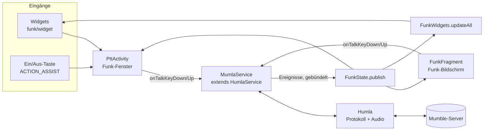

# Architektur von Mumla Funk

Dieses Dokument beschreibt, was Mumla Funk auf Mumla aufsetzt, wie die Teile zusammenspielen
und warum sie so gebaut sind. Für Überblick, Bauen und Releases siehe das [README](../README.md).

Mumla Funk besteht aus drei Schichten:

1. **Humla** (`libraries/humla/`): das Mumble-Protokoll, also Verbindung, Audio und Codecs.
   Unverändert aus Mumla übernommen, bis auf den [Ende-Flag-Fix](#ende-flag-terminator).
2. **Mumla** (`app/`, Pakete außer `funk`): Vordergrunddienst, Kanäle, Chat, Serverliste,
   Zertifikate und Einstellungen. Nahezu unverändert.
3. **Funk** (`app/src/main/java/se/lublin/mumla/funk/`): die Walkie-Talkie-Bedienung. Sie
   spricht ausschließlich über die vorhandenen Service-Schnittstellen mit dem Backend.

## Überblick

## Klassen und Dateien

| Datei | Aufgabe |
|---|---|
| `funk/FunkState.java` | Unveränderlicher Schnappschuss: Verbindung, Server, eigener Kanal, alle Teilnehmer, wer spricht, ob man stumm ist. Statischer „aktueller Zustand“ plus Listener. |
| `funk/PttActivity.java` | Funk-Fenster: großer Sprechknopf für einen Server, Verbindungsaufbau, Fehleranzeige, Leiser-Taste als Sprechtaste. |
| `funk/PttButtonView.java` | Der runde Knopf als eigene View: Zustände OFFLINE, CONNECTING, READY, TALKING, MUTED; Puls-Animation, Haptik, Touch-Logik (halten oder tippen). |
| `funk/FunkFragment.java` | Funk-Bildschirm in der App, solange man mit einem Funk-Server verbunden ist: Server, Status, Sprechknopf, Teilnehmerliste. |
| `funk/FunkPrefs.java` | Einstellungen der Funk-Funktionen: Funk-Server ja/nein je Server, zuletzt genutzter Server, Server je Widget, Leiser-Taste im Fenster. |
| `funk/BatteryOptimization.java` | Status der Akku-Ausnahme und Link in die Systemliste (ohne eigene Berechtigung). |
| `funk/FunkServers.java` | Gespeicherte Server laden, Standard-Server auflösen, Anzeigenamen. |
| `funk/widget/FunkWidgets.java` | Baut die `RemoteViews` beider Widgets aus `FunkState`. |
| `funk/widget/FunkWidgetSmall.java`, `FunkWidgetLarge.java`, `FunkWidgetProvider.java` | Die zwei `AppWidgetProvider`. |
| `funk/widget/FunkWidgetConfigActivity.java` | Serverauswahl beim Platzieren eines Widgets (auch nachträglich über „Widget anpassen“). |
| `preference/FunkSettingsFragment.java`, `res/xml/settings_funk.xml` | Einstellungen › Funk: Ein/Aus-Taste, Leiser-Taste im Fenster, Energiesparen, Akku-Ausnahme. |
| `res/values*/strings_funk.xml`, `colors_funk.xml` | Texte (Englisch, Deutsch) und Farben der Funk-Oberfläche. |

Geänderte Mumla-Dateien:

| Datei | Änderung |
|---|---|
| `service/MumlaService.java` | Veröffentlicht `FunkState` und aktualisiert die Widgets bei Ereignissen. Der TALK-Broadcast ist entfernt (siehe [Sicherheit](#sicherheit)). |
| `app/MumlaActivity.java` | Serverliste als Start. Nach dem Verbinden Funk-Bildschirm oder Kanalliste, je nach Server. Merkt sich den zuletzt genutzten Server. Nimmt `EXTRA_CONNECT_SERVER_ID` aus dem Funk-Fenster an. Erzeugt beim ersten Start still ein Zertifikat. |
| `app/DrawerAdapter.java` | Menüeintrag „Funk“ unter dem verbundenen Server, „Meine Server“. |
| `servers/ServerEditFragment.java`, `res/layout/dialog_server_edit.xml` | Formular mit Beispielen, Hinweisen, Prüfung der Felder und dem Schalter „Funk-Server“. |
| `servers/FavouriteServerListFragment.java`, `res/layout/fragment_server_list.xml` | Willkommen-Seite ohne Server, Hinweis und Knopf „Server hinzufügen“, Funk-Kennzeichen je Server. |
| `res/values*/themes.xml`, `colors.xml` | Kontraste im dunklen Design (siehe [Farben](#farben-und-kontrast)). |
| `Settings.java`, `res/xml/settings_audio.xml` | Push-to-Talk als Standard. |
| `preference/MumlaPreferenceFragment.java` | Interne Einstellungs-Links fest an das eigene Paket gebunden (siehe [Eigene App-ID](#eigene-app-id)). |
| `channel/ChannelFragment.java`, `service/MumlaHotCorner.java`, `service/MumlaOverlay.java` | Senden endet auch bei abgebrochener Berührung (`ACTION_CANCEL`). |
| `AndroidManifest.xml` | Funk-Fenster, Widgets und Widget-Einrichtung. Dienst und interne Activities nicht exportiert. |

## Zustand: FunkState

`MumlaService` registriert einen eigenen `HumlaObserver` (`mFunkObserver`). Aus den Ereignissen
baut `FunkState.build(service)` einen Schnappschuss. `FunkState.publish()` meldet ihn an alle
Listener, danach rendert `FunkWidgets.updateAll()` die Widgets.

Wann veröffentlicht wird:

- **Sofort**: bei Verbindung, Verbindungsaufbau und Trennung.
- **Gebündelt nach 150 ms** (`FUNK_UPDATE_DELAY_MS`): bei Teilnehmer-, Kanal- und
  Sprech-Ereignissen. Diese kommen beim Sprechen in schneller Folge.

Der Schnappschuss wird auf dem Main-Thread gebaut. Humla aktualisiert sein Modell ebenfalls
dort, Lesen ist also sicher.

Die Teilnehmerliste enthält alle Nutzer des Servers. Nutzer im eigenen Kanal stehen zuerst,
danach wird nach Kanal und Name sortiert.

Die Oberflächen fragen nie den Service nach dem Zustand, sie zeigen nur `FunkState` an. Auch
Widgets brauchen dafür keinen Datenbankzugriff: Den Servernamen eines Widgets speichert
`FunkPrefs` beim Einrichten.

## Funk-Server oder normaler Server

Für jeden gespeicherten Server steht in `FunkPrefs` unter `funk_server_mode_<id>`, ob er ein
Funk-Server ist. Ohne Eintrag gilt „ja“, so bleiben Server aus 1.0.4 und älter Funk-Server.
Gesetzt wird der Wert über den Schalter im Server-Formular, beim Löschen eines Servers wird er
entfernt. In der Serverdatenbank von Mumla ändert sich nichts, es gibt keine Migration.

`MumlaActivity.showConnectedScreen()` entscheidet nach dem Verbinden:

- Funk-Server: `FunkFragment` (Funk-Bildschirm).
- Sonst, auch bei nicht gespeicherten Servern (öffentliche Server, „Schnell verbinden“,
  `mumble://`-Links): `ChannelFragment` (Mumla).
- Mit Mumlas Einstellung „Angepinnte Kanäle beim Start“ wie bisher die angepinnten Kanäle.

Der Funk-Bildschirm ist über das Menü auch bei normalen Servern erreichbar. Funk-Fenster und
Widgets funktionieren mit jedem gespeicherten Server, das Kennzeichen steuert nur die Ansicht
in der App. Wird die Verbindung getrennt, zeigt die App wieder die Serverliste. Während einer
Neuverbindung bleibt der Funk-Bildschirm stehen und zeigt „Verbindung verloren, verbinde neu“,
statt eines Dialogs.

## Sprechen

Alle Sprechwege rufen `IMumlaService.onTalkKeyDown()` und `onTalkKeyUp()` auf. Das sind
dieselben Methoden wie bei Mumlas Sprechtaste:

- Touch auf `PttButtonView` (Funk-Fenster und Funk-Bildschirm),
- Leiser-Taste im offenen Funk-Fenster,
- die in den Einstellungen gewählte PTT-Taste.

Damit gelten Eingabemodus und „PTT umschalten“ aus den Einstellungen überall.

Sicherungen gegen hängendes Senden:

- `ACTION_CANCEL` beendet das Senden wie `ACTION_UP`. Das passiert z. B., wenn man die
  Benachrichtigungsleiste herunterzieht oder eine Geste die Berührung abbricht.
- `PttActivity.onPause()` beendet das Senden, wenn das Fenster verschwindet (Bildschirm aus,
  Home-Taste).
- `PttButtonView.setMode()` beendet ein laufendes Halten, wenn Sprechen nicht mehr möglich ist
  (getrennt, stummgeschaltet).

Solange der Finger drückt, zeigt der Knopf sofort „Sendet“, ohne auf die Rückmeldung des
Servers zu warten. Im Umschaltmodus gilt das nicht.

## Funk-Fenster (PttActivity)

| Bereit | Sendet | Nicht verbunden |
|:---:|:---:|:---:|
|  |  |  |

- **Darstellung**: transparentes Theme `Theme.Mumla.FunkPopup` mit einer dunklen Karte unten.
  Text-Knöpfe nutzen dort `funk_accent_light`, da `funk_accent` auf der dunklen Karte zu wenig
  Kontrast hat.
  Ein Tipp daneben schließt das Fenster. Nach 30 s ohne Bedienung schließt es sich von selbst,
  aber nie während des Sendens.
- **Fenster-Eigenschaften**:
  - `launchMode="singleTask"` mit eigener `taskAffinity` und `excludeFromRecents`: Das Fenster
    holt nicht die ganze App nach vorn und taucht nicht in „Zuletzt verwendet“ auf.
  - `showWhenLocked` und `turnScreenOn`: Es erscheint auch über dem Sperrbildschirm.
- **Welcher Server**: In dieser Reihenfolge gilt
  1. die Server-ID aus dem Intent (`EXTRA_SERVER_ID`, z. B. von einem Widget). Gibt es den
     Server nicht mehr, zeigt das Fenster „Server gelöscht“ und weicht nicht auf einen anderen
     Server aus,
  2. die aktuelle Verbindung,
  3. der zuletzt genutzte Server,
  4. der erste gespeicherte Server.
- **Verbinden**: Das Fenster prüft zuerst die Mikrofon-Berechtigung, fragt einmalig nach der
  Benachrichtigungs-Berechtigung und prüft Tor. Danach startet `ServerConnectTask`, derselbe
  Weg wie in Mumla. Mit `EXTRA_AUTO_CONNECT` verbindet es sich sofort beim Öffnen.
- **Serverwechsel**: Ist die App mit einem anderen Server verbunden, wird erst getrennt und auf
  `onDisconnected` gewartet, höchstens 4 s. Humlas `connect()` schließt eine bestehende
  Verbindung nicht selbst.
- **Fehler**:
  - Ein unbekanntes Server-Zertifikat oder ein falsches Passwort braucht die Dialoge der App.
    „In App öffnen“ startet `MumlaActivity` mit `EXTRA_CONNECT_SERVER_ID`, die App verbindet
    sich dann und zeigt den Dialog.
  - Bei gesperrtem Gerät wird vorher mit `requestDismissKeyguard` entsperrt.

## Hardware-Tasten

### Ein/Aus-Taste

Apps bekommen die Ein/Aus-Taste nie zu sehen. Der einzige Weg ist die Assistent-Funktion:
`PttActivity` hat einen Intent-Filter für `android.intent.action.ASSIST`. Dadurch erscheint
Mumla Funk in der Auswahl „Standard-App für den digitalen Assistenten“. Ist die App dort
gewählt, startet langes Drücken der Ein/Aus-Taste das Funk-Fenster.

Android meldet dabei nicht, wann die Taste losgelassen wird. Halten zum Sprechen ist über die
Ein/Aus-Taste deshalb nicht möglich, sie öffnet nur das Fenster.

Ob die Rolle aktiv ist, prüft `FunkSettingsFragment` per `RoleManager.isRoleHeld(ROLE_ASSISTANT)`.

### Leiser-Taste

Nur im offenen Funk-Fenster ist die Leiser-Taste eine Sprechtaste (`PttActivity.onKeyDown`).
Bis 1.0.4 öffnete sie über eine Bedienungshilfe (`FunkKeyService`) das Fenster auch aus dem
Hintergrund. Die Bedienungshilfe ist entfernt, da Google Play dafür eine eigene Erklärung mit
Video verlangt und sie das größte Ablehnungsrisiko war.

## Widgets

- **Nur Tippen**: Widgets bestehen aus `RemoteViews`. Sie kennen nur Klicks (`PendingIntent`),
  kein Halten und Loslassen. Darum öffnen beide Widgets das Funk-Fenster.
- **Server je Widget**: Beim Platzieren fragt `FunkWidgetConfigActivity` nach dem Server.
  Gespeichert wird er in `FunkPrefs` unter `funk_widget_server_<id>` samt Namen. Wird der
  Server umbenannt, aktualisiert `FunkWidgets.onServerRenamed()` den Namen.
  `widgetFeatures="reconfigurable"` erlaubt das spätere Ändern.
- **Aktualisierung**: Die Widgets haben keinen Timer (`updatePeriodMillis="0"`). Die Daten
  schiebt `MumlaService` bei jeder Zustandsänderung.
- **Zustände**: Ein Widget zeigt nur dann „verbunden“, wenn die App mit *seinem* Server
  verbunden ist. Sonst erscheint der durchgestrichene Funkmast, beim großen Widget mit
  „Aktiv: anderer Server“.
  - „Verbinden“ öffnet das Funk-Fenster mit `EXTRA_AUTO_CONNECT`.
  - „Sprechen“ öffnet es ohne.
- **Teilnehmerliste im großen Widget**: Zeilen werden mit `RemoteViews.addView()` eingefügt.
  Wie viele passen, folgt aus der aktuellen Widget-Höhe. Der Rest erscheint als „+N weitere“.
- **Keine Kollisionen**: `PendingIntent`s erhalten je Widget und Aktion eigene Daten-URIs und
  Request-Codes, damit sie sich nicht gegenseitig überschreiben.

## Ende-Flag (Terminator)

### Hintergrund

Mumble-Sprachpakete im klassischen UDP-Format haben diesen Aufbau:

- ein Kopfbyte mit Codec und Ziel,
- eine Sequenznummer,
- die Audiodaten.

Bei **Opus** steht vor den Daten deren Länge. Bit 13 (`0x2000`) dieser Länge markiert das
letzte Paket einer Durchsage, den Terminator. Bei **CELT/Speex** hat jeder Frame ein
Längenbyte mit Fortsetzungsbit `0x80`, und ein leerer Frame am Ende markiert den Terminator.

Empfänger und serverseitige Effekte erkennen daran sofort, dass eine Durchsage zu Ende ist.
Fehlt das Flag, bleibt ihnen nur ein Timeout.

### Der Fehler in Humla

`AudioHandler.onAudioInputReceived()` rief beim Ende des Sprechens zwar `terminate()` auf. Der
Opus-Encoder setzte das Flag aber nur, wenn noch ungesendetes Audio im Puffer lag.

Standardmäßig fasst ein Paket 2 Frames zusammen. Etwa jedes zweite Mal war der Puffer beim
Loslassen gerade leer, weil das letzte Paket kurz vorher rausgegangen war. Dann wurde gar kein
Abschlusspaket gesendet. Bei 1 Frame pro Paket fehlte das Flag sogar immer. Der CELT-Encoder
setzte nie einen Terminator.

### Der Fix

Ein Commit mit dem Titel „Always send the end-of-transmission flag …“ ändert zwei Dateien:

- `libraries/humla/src/main/java/se/lublin/humla/protocol/AudioHandler.java`: Beim Übergang
  von „spricht“ zu „spricht nicht“ wird zuerst ein stiller Abschluss-Frame codiert, danach
  `terminate()` aufgerufen. So gibt es immer ein letztes Paket, und es trägt das Flag. Die
  Stille-Frames, mit denen `terminate()` ein Paket auffüllt, zählt der Code mit. Die
  Sequenznummer des letzten Pakets überlappt dadurch nicht mit der des vorigen.
- `libraries/humla/src/main/java/se/lublin/humla/audio/encoder/CELT7Encoder.java`: hängt den
  leeren Terminator-Frame an.

Wer Humla aktualisiert, muss diesen Commit wieder anwenden. Darum liegt Humla jetzt im Repo
statt als Submodul: Das Original auf GitLab kann man nicht patchen.

Humla spricht das klassische UDP-Format. Mumble-Server ab Version 1.5 nehmen es von älteren
Clients weiterhin an.

## Eigene App-ID

Damit Mumla Funk neben Mumla installierbar ist:

- **Application-ID** `de.filubu.funk`, abgeleitet von der Domain `filubu.de`. Bis 1.0.3
  war es `io.github.filubu.mumlafunk`. Build-Varianten (Flavors) gibt es seit 1.0.5 nicht mehr.
- **Java-Pakete** bleiben `se.lublin.mumla`. Das erleichtert das Übernehmen von
  Mumla-Updates.
- **Such-Provider**: Seine Authority wird aus der Application-ID gebildet
  (`${applicationId}.channel.ChannelSearchProvider`, in `searchable.xml` über die in
  `app/build.gradle` gesetzte Ressource `search_authority`). Eine feste Authority würde die Installation neben
  Mumla mit `INSTALL_FAILED_CONFLICTING_PROVIDER` scheitern lassen.
- **Einstellungs-Links**: Die Zertifikat-Einstellungen öffnen eigene Activities über implizite
  Intents `se.lublin.mumla.app.*`. `MumlaPreferenceFragment` setzt dafür das eigene Paket,
  sonst könnte Android Mumlas Activities öffnen.
- **Version** wird in `app/build.gradle` gepflegt (`funkVersion`, `versionCode`), nicht mehr
  über `git describe`.

## Sicherheit

- `MumlaService` ist nicht exportiert. In Mumla konnte jede App auf dem Gerät den Dienst mit
  `ACTION_CONNECT` und eigenen Extras starten, also eine Verbindung zu einem fremden Server
  aufbauen, samt Sprachaktivierung.
- Humla meldet in seinem Bibliotheks-Manifest den eigenen `HumlaService` exportiert an, mit den
  Aktionen `ACTION_CONNECT` und `ACTION_DISCONNECT`. Die App entfernt diesen Eintrag
  (`tools:node="remove"` im App-Manifest), sie nutzt nur `MumlaService`.
- Der Broadcast `se.lublin.mumla.action.TALK` ist entfernt. Er war exportiert, jede App konnte
  damit während einer Verbindung das Senden einschalten.
- Die Empfänger der Benachrichtigungs-Knöpfe sind auf allen Android-Versionen nicht exportiert
  (`ContextCompat.registerReceiver` mit `RECEIVER_NOT_EXPORTED`), nicht erst ab Android 14.
- Die Zertifikat-Activities sind nicht exportiert. Die Einstellungen öffnen sie mit dem eigenen
  Paket, siehe [Eigene App-ID](#eigene-app-id).

## Farben und Kontrast

Material 3 nutzt `colorPrimary` für Text-Knöpfe, Schalter, Überschriften und gefüllte Knöpfe,
aber über `colorPrimaryDark` auch für Drawer, Statusleiste (DrawerLayout) und App-Leiste. Im
dunklen Design war `colorPrimary` ein fast schwarzes Blau (`#001b2b`), alles damit Gezeichnete
war auf dem dunklen Hintergrund kaum zu sehen (etwa 1,1:1). Seit 1.0.5:

- `colorPrimaryDark` ist die App-Leisten-Farbe (hell `#3949ab`, dunkel `#001b2b`). Sie färbt
  App-Leiste, Statusleiste, Drawer, Kopf des Drawers, Kanal-Tabs und den PTT-Balken von Mumla.
- `colorPrimary` ist im dunklen Design ein helles Indigo (`#b9c3ff`, 10,9:1), dazu passende
  Container-Farben statt der lila Material-Standardwerte.
- Grüner Text („Max spricht“) und das grüne Status-Symbol nutzen `funk_live_text`:
  `#2E7D32` auf hellem Grund (4,8:1), `#66BB6A` im dunklen Design.
- Deaktivierte Einträge im Drawer haben 55 % statt 33 % Deckkraft.

## Ideen und offene Punkte

- Automatische Tests für `FunkState` (Sortierung, Zustände) und die Widget-Logik.
- Optionaler Tonhinweis beim Start und Ende des Sendens.
- Bluetooth-Headset- oder Funk-Taste (`KEYCODE_HEADSETHOOK` / Media-Button) als Sprechtaste.
- Die übrigen Sprachen der Store-Texte unter `fastlane/` stammen noch von Mumla. Angepasst
  sind nur `en-US` und `de`.
